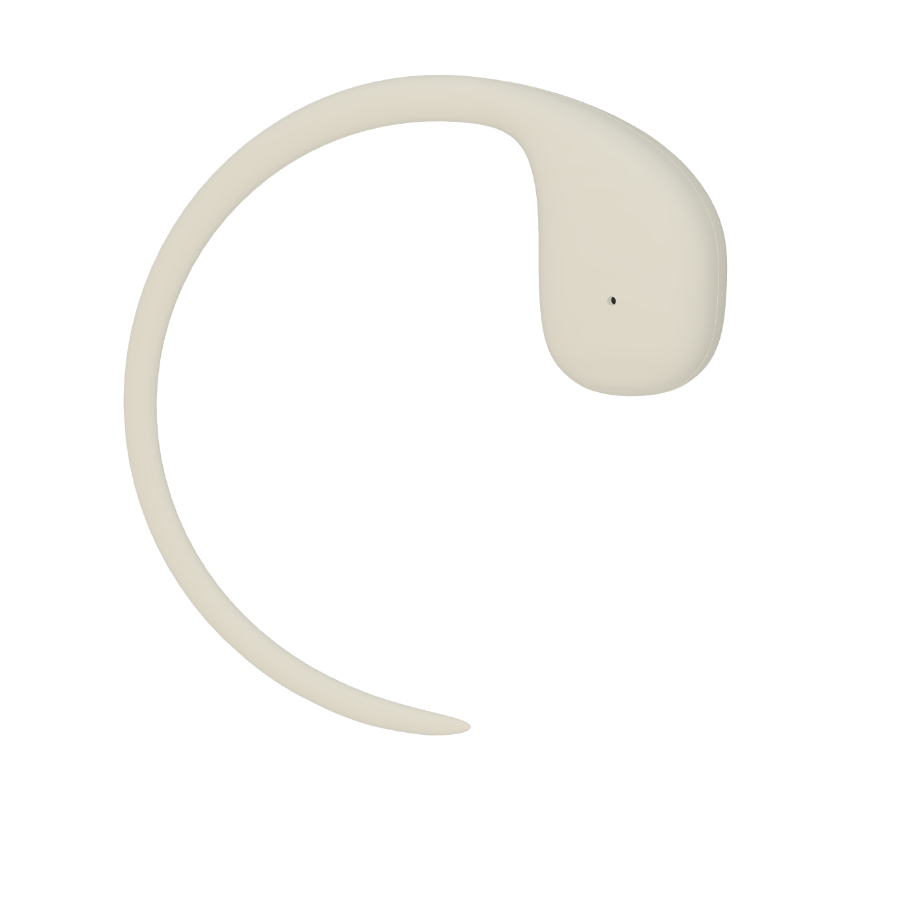
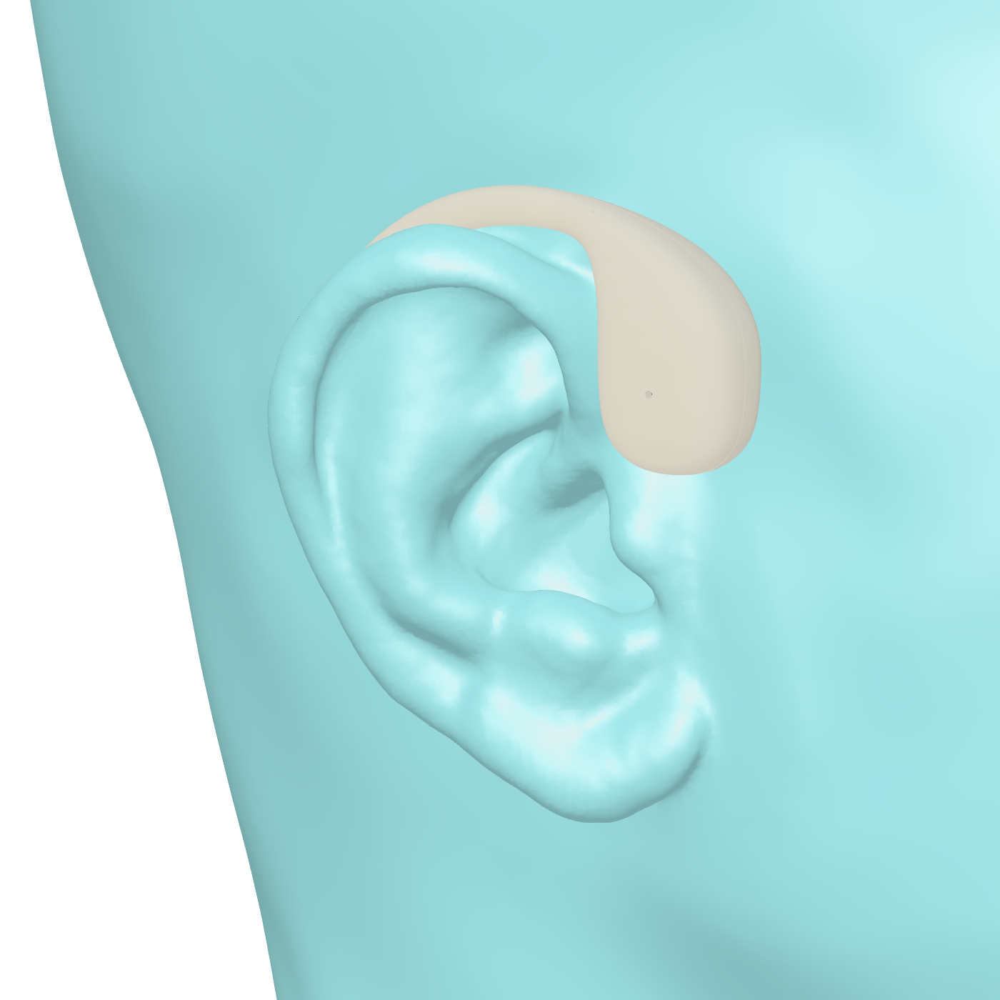
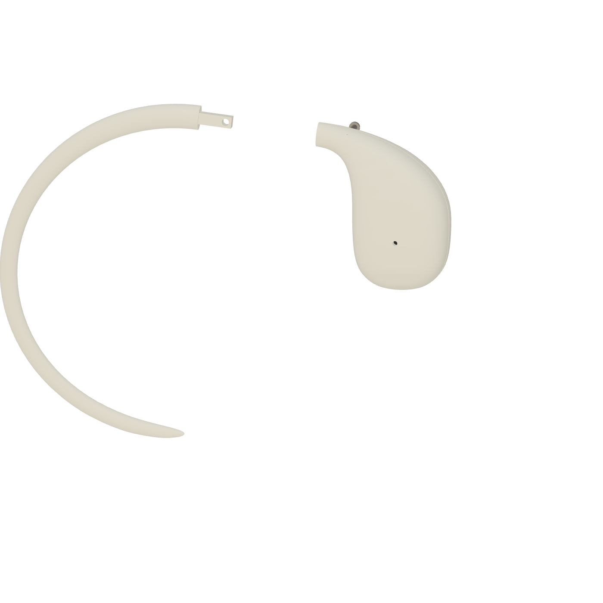
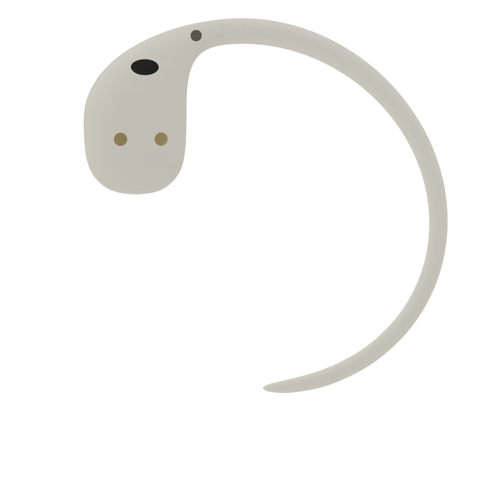
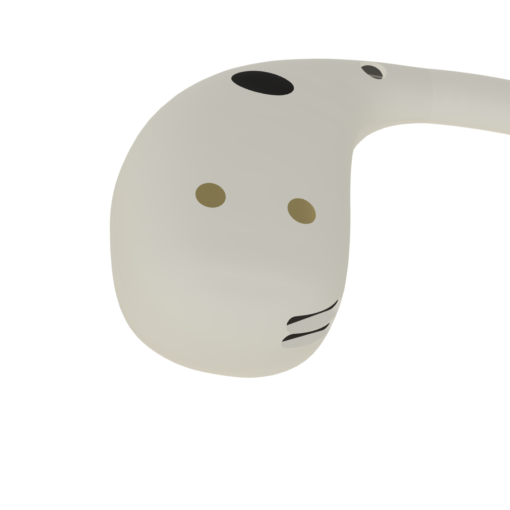
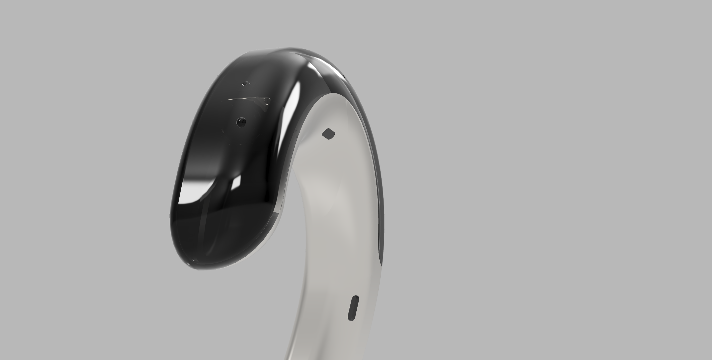
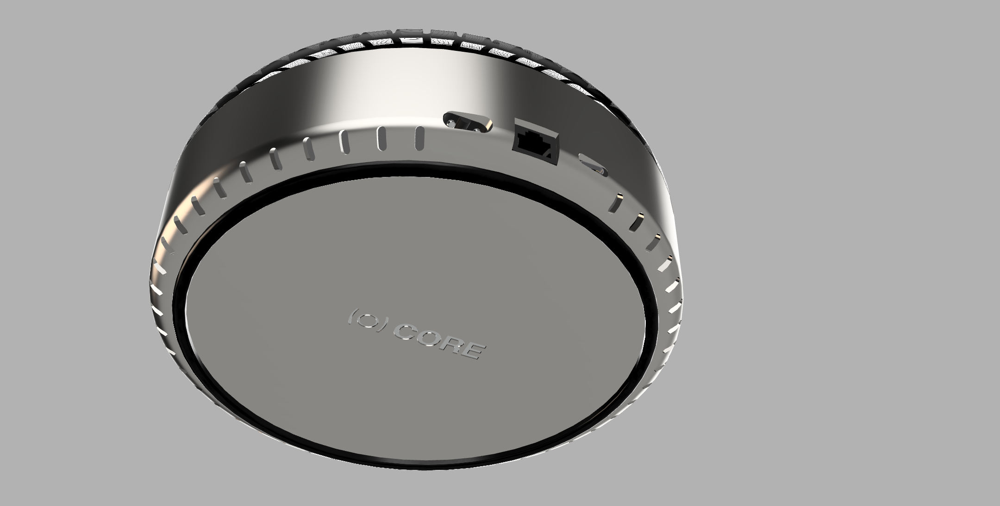

# Omni

Omni is an audio-first AI earpiece concept built around a simple idea: personal
technology should work for its owner, without adding another screen or turning
the owner's life into an advertising dataset.

This repository is a visual record of the hardware's progression from early
industrial-design renders to a native Autodesk Fusion fit and packaging
prototype.

## Revision 13

Revision 13 is the current Omni Basic hardware baseline. It combines a compact
rigid lobe with a close-fitting, removable silicone tail intended to route
behind the ear.

| Assembled concept | Fit study |
| --- | --- |
|  |  |

| Removable tail | Inner geometry |
| --- | --- |
|  |  |

The Fusion model includes:

- a rigid lobe with packaging allocations for a battery and receiver;
- a tapered silicone tail with a formable internal core;
- a keyed, screw-retained removable tail connection;
- two acoustic outlet references aimed toward the open canal/concha region;
- native archive, interference, clearance, and printable-mesh checks.

The model was developed and saved natively in Autodesk Fusion. Four exported
print meshes were checked as watertight and consistently wound.

## Earlier Concepts

The early renders explored product identity, color, surface language, and the
relationship between a wearable earpiece and a local compute device. They were
useful for making the idea visible before the work moved into fit, packaging,
and manufacturable geometry.

| Wearable concept | Color exploration |
| --- | --- |
|  |  |

## Product Direction

Omni Basic is planned as a companion-dependent, audio-only earpiece that works
with a nearby phone or personal computer. The broader product direction
emphasizes user control, explicit recording state, repairable hardware, and
personal context that remains under the owner's control.

The next milestones are physical fit testing, acoustics, electronics, battery
life, charging, manufacturability, and a narrow companion experience.

## Current Limits

Revision 13 is a fit and packaging prototype for one reference anatomy. It is
not proof of comfort, acoustic performance, runtime, water resistance,
population fit, regulatory compliance, or production readiness. The acoustic
targets are layout references, not clinically identified internal anatomy.

Design and renders by Mads Feiring. All rights reserved.
