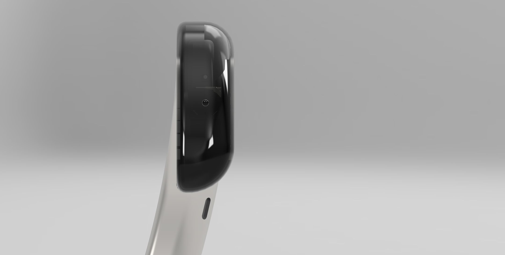
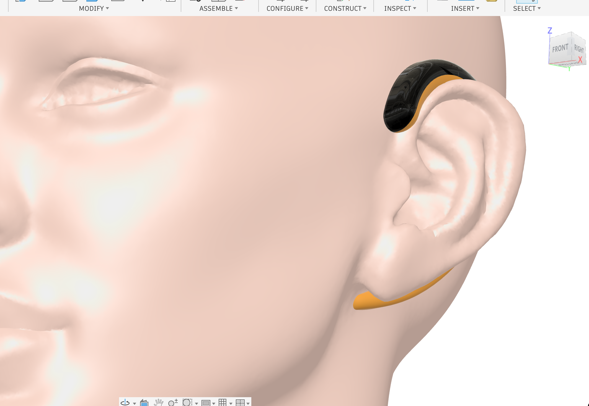

# Omni

Omni is a personal AI earpiece concept built around a simple idea: personal
technology should work for its owner instead of turning the owner's life into
an advertising dataset.

The product line has two distinct tiers. **Omni Basic** is an audio-only,
companion-dependent earpiece and the first hardware priority. **Omni Pro** is a
camera-enabled, more independent version for people who want visual context as
well as audio.

## Product Line

| | Omni Basic | Omni Pro |
| --- | --- | --- |
| Primary input | Audio only | Audio plus camera-enabled visual context |
| Connectivity | Uses a nearby phone or personal computer | Targets independent cellular connectivity |
| Enclosure direction | Polycarbonate or similar engineering thermoplastic with a soft silicone tail | Premium or hybrid materials, subject to camera, antenna, thermal, and weight requirements |
| Privacy signal | Explicit audio-recording state | Explicit, highly visible camera and audio recording state |
| Current stage | Native Fusion Revision 13 fit and packaging prototype | Industrial-design and fit concept; camera hardware is not yet implemented |

## Omni Basic

### Revision 13

Revision 13 is the current Omni Basic hardware baseline. It combines a compact
rigid lobe with a close-fitting, removable silicone tail intended to route
behind the ear. Basic deliberately omits a camera and depends on a nearby
companion device for wide-area connectivity.

| Assembled concept | Fit study |
| --- | --- |
|  |  |

| Removable tail | Inner geometry |
| --- | --- |
|  |  |

The Fusion model includes:

- a rigid lobe with packaging allocations for a battery and receiver;
- a tapered silicone tail with a formable internal core;
- a keyed, screw-retained removable tail connection;
- two acoustic outlet references aimed toward the open canal/concha region;
- native archive, interference, clearance, and printable-mesh checks.

The model was developed and saved natively in Autodesk Fusion. Four exported
print meshes were checked as watertight and consistently wound.

## Omni Pro

Omni Pro adds a forward-facing camera so the assistant can work with visual
context as well as voice. The dark front surface is the visual and sensor
region; any production camera would be paired with a conspicuous, hard-to-miss
recording indicator and user-controlled capture behavior.

| Camera-enabled concept | Side profile |
| --- | --- |
|  |  |

Pro is a separate engineering track rather than a cosmetic upgrade to Basic.
Its camera, target cellular radio, antenna, battery, thermal load, privacy
indicator, sealing, and premium-material requirements may require a different
internal architecture and enclosure volume.

The images above establish the industrial-design and fit direction. They do not
show a completed camera module, cellular system, electronics package, or
production-ready enclosure.

## Shared Direction

Basic and Pro are intended to share the assistant experience, voice interaction,
privacy model, fit-testing knowledge, and as much software as practical. Both
tiers emphasize user control, explicit recording state, repairable hardware,
and personal context that remains under the owner's control.

The next milestones are physical fit testing, acoustics, electronics, battery
life, charging, manufacturability, and a narrow companion experience for Basic.
Pro additionally requires camera, RF, thermal, privacy-indicator, and regulatory
feasibility work.

## Current Limits

Revision 13 is a Basic fit and packaging prototype for one reference anatomy.
It is not proof of comfort, acoustic performance, runtime, water resistance,
population fit, regulatory compliance, or production readiness. The acoustic
targets are layout references, not clinically identified internal anatomy.
Omni Pro remains a concept and has not established camera performance,
standalone connectivity, sealing, thermal behavior, or manufacturability.

Design and renders by Mads Feiring. All rights reserved.
